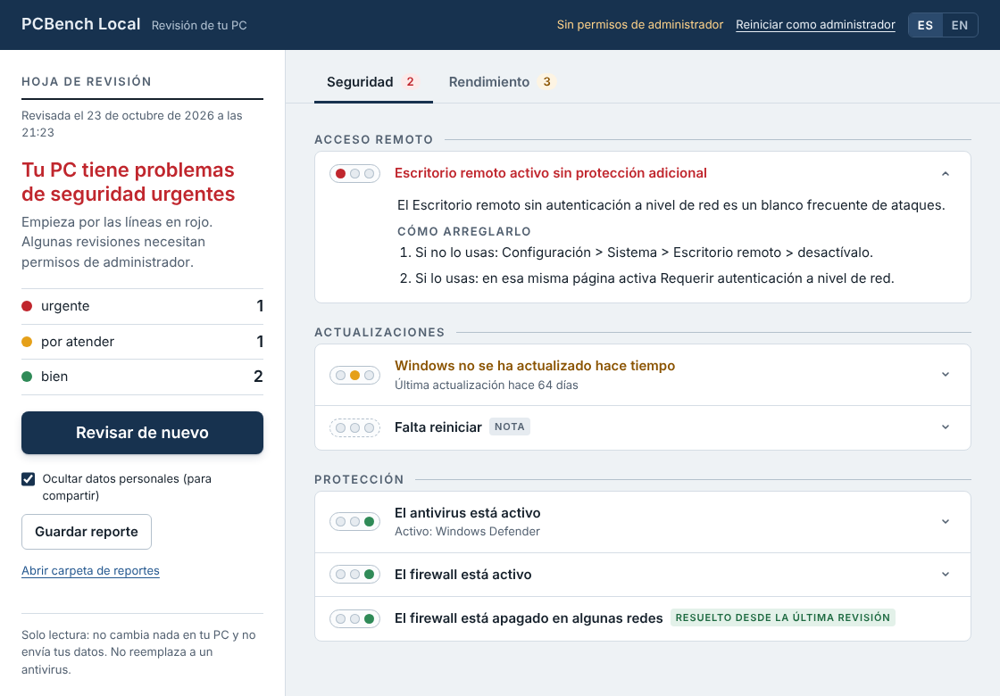
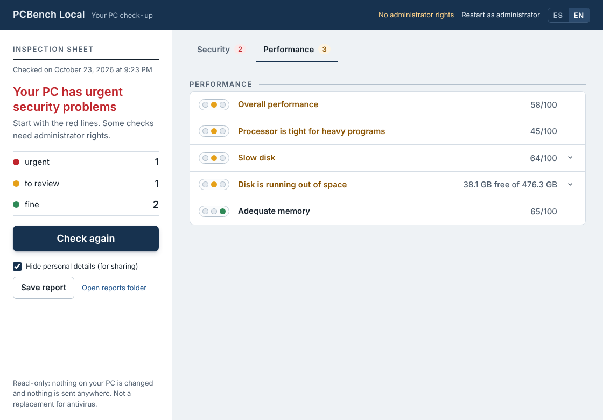
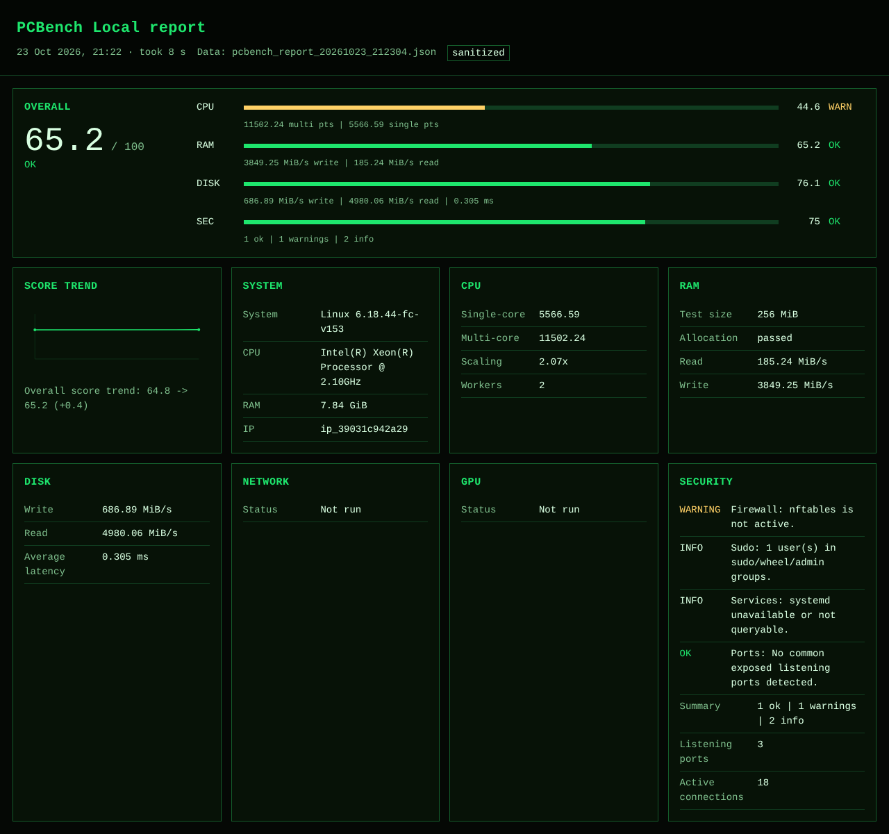

# PCBench Local

**Is my PC safe? Is it performing well? One button, plain answers, step-by-step fixes.**
A free, read-only check-up for Windows PCs, in Spanish and English. It reviews your security settings
first and your hardware second, and tells you exactly what to do about each problem.

No account, no telemetry, no uploads. Everything runs and stays on your computer.
**It is not an antivirus**: it checks how your PC is configured, not whether it is infected.


<sub>Screenshot with sample data.</sub>

## How it works

1. Open **PCBench** and press **Check my PC** (*Revisar mi PC*). It takes about two minutes.
2. Every check becomes a line with three lights: **red** fix now, **amber** should fix, **green** fine.
3. Open a red or amber line to read why it matters and the numbered steps to fix it yourself.
4. Save a report to send to a technician. Personal details (IP, PC name, user name) are hidden by default.
5. Check again later: problems you fixed stay on the sheet marked *fixed since the last check*.



## What it checks

| Area | Checks |
|---|---|
| Protection | Antivirus registered with Windows Security (any brand, not only Defender), definitions age, Tamper Protection, firewall per network, SmartScreen, Secure Boot, disk encryption (BitLocker) |
| Updates | Days since the last Windows update, pending restart |
| Accounts | User Account Control, Guest account, automatic sign-in and stored password (presence only, never the password) |
| Remote access | Remote Desktop and Network Level Authentication, SMBv1, services reachable from the network |
| Performance | Processor, memory speed and how full it is, disk speed and free space, internet stability, graphics card temperature |

Measurements repeat several times and report the median with a confidence level; disk reads bypass the
Windows file cache so you see the disk's real speed, not RAM.

## Download

Tagged [releases](https://github.com/amaragioglio/pcbench-local/releases) include:

- `PCBench-<version>-windows.exe`: the window, for everyone.
- `pcbench-cli-<version>-windows.exe`: the terminal tool, for technicians.

They are unsigned, so Windows SmartScreen may warn you: choose **More info → Run anyway**, or build
from source. For the full security check, right-click and choose **Run as administrator** (the app also
offers to restart itself as administrator).

## Run from source

**Windows** (Python 3.11+):

```powershell
git clone https://github.com/amaragioglio/pcbench-local.git
cd pcbench-local
.\setup.bat                                   # creates .venv and installs dependencies
.\.venv\Scripts\python.exe main.py app         # desktop window
.\pcbench.bat                                 # terminal wizard
```

**Linux / macOS** (the window needs pywebview and a system webview; the security audit is Windows-first):

```bash
python3 -m venv .venv && ./.venv/bin/pip install -r requirements.txt pywebview
./.venv/bin/python main.py app
```

## For technicians: the terminal tool

The original terminal interface stays available with every option: profiles, report formats (JSON,
HTML, DOCX, Markdown, Supabase), comparisons, SQLite history and weekly scheduling.



## Privacy and security

- **Nothing is uploaded.** Reports, logs and history are written only to your reports folder.
- **The audit is read-only.** It never changes firewall, Defender, services or users.
- **Share with `--sanitize`.** Hostnames, IPs, MAC addresses, usernames, user folders, command paths and
  connection endpoints are replaced with tokens. Tokens are keyed with a random secret per run, so the
  same IP looks the same inside one report but cannot be recovered by guessing.
- Without administrator/root rights the audit still runs and is marked `partial: true`.
- Network checks contact only the targets listed in [SECURITY.md](SECURITY.md).

```powershell
.\.venv\Scripts\python.exe main.py run --quick --sanitize --reports json,html,md
```

## More commands

Examples use the Windows virtual environment path; on Linux/macOS use `./.venv/bin/python`.

Version:

```powershell
.\.venv\Scripts\python.exe main.py --version
```

Quick profile:

```powershell
.\.venv\Scripts\python.exe main.py run --quick
```

Full profile:

```powershell
.\.venv\Scripts\python.exe main.py run --full
```

Shareable sanitized report:

```powershell
.\.venv\Scripts\python.exe main.py run --quick --sanitize --reports json,html,supabase
```

Custom output directory and retention:

```powershell
.\.venv\Scripts\python.exe main.py run --quick --output-dir D:\PCBench\reports --keep-last 20
```

Compare the two latest JSON reports:

```powershell
.\.venv\Scripts\python.exe main.py compare
```

Compare only reports from the same profile:

```powershell
.\.venv\Scripts\python.exe main.py compare --profile quick
```

Compare specific files:

```powershell
.\.venv\Scripts\python.exe main.py compare --base reports\old.json --current reports\new.json
```

Show local SQLite history:

```powershell
.\.venv\Scripts\python.exe main.py history --limit 10
```

Preview weekly scheduling:

```powershell
.\.venv\Scripts\python.exe main.py schedule --dry-run
```

Install a weekly Windows Scheduled Task:

```powershell
.\.venv\Scripts\python.exe main.py schedule
```

## Options

```powershell
.\.venv\Scripts\python.exe main.py run --no-save
.\.venv\Scripts\python.exe main.py run --skip-ram
.\.venv\Scripts\python.exe main.py run --skip-cpu
.\.venv\Scripts\python.exe main.py run --skip-disk
.\.venv\Scripts\python.exe main.py run --skip-network
.\.venv\Scripts\python.exe main.py run --skip-gpu
.\.venv\Scripts\python.exe main.py run --skip-security
.\.venv\Scripts\python.exe main.py run --ram-mib 2048
.\.venv\Scripts\python.exe main.py run --cpu-seconds 10
.\.venv\Scripts\python.exe main.py run --disk-mib 1024
.\.venv\Scripts\python.exe main.py run --speedtest
.\.venv\Scripts\python.exe main.py run --reports json,html,supabase
.\.venv\Scripts\python.exe main.py run --sanitize
.\.venv\Scripts\python.exe main.py run --output-dir .\reports --keep-last 20
.\.venv\Scripts\python.exe main.py run --elevate
```

## Reports

Default report directory:

- Windows: `~/Documents/PCBench/reports`
- Linux/macOS: `~/PCBench/reports`

Generated artifacts:

- `pcbench_report_*.json`: complete data for comparison.
- `pcbench_report_*.html`: browser-friendly visual summary.
- `pcbench_report_*.docx`: document you can open with OnlyOffice or Word.
- `pcbench_report_*.md`: Markdown summary for GitHub.
- `pcbench_supabase_*.json`: flat payload for Supabase.
- `pcbench.log`: local rotating runtime log.
- `pcbench_history.sqlite`: local SQLite history for runs, metrics and findings.

When history has at least two rows, HTML reports include an inline score trend chart.

### Supabase JSON

The Supabase export contains these flat table keys:

- `pcbench_runs`
- `pcbench_metrics`
- `pcbench_findings`

Each key contains rows designed for import or insert into Supabase tables.

## Optional Speedtest

`--speedtest` requires the optional `speedtest-cli` package:

```powershell
.\.venv\Scripts\python.exe -m pip install speedtest-cli
```

## Docker

Build image:

```powershell
docker build -t pcbench-local .
```

Run quick profile:

```powershell
docker run --rm -it pcbench-local
```

Save reports to a local folder:

PowerShell:

```powershell
docker run --rm -it -v ${PWD}\reports:/app/reports pcbench-local run --quick --output-dir /app/reports --skip-security
```

Bash:

```bash
docker run --rm -it -v "$PWD/reports:/app/reports" pcbench-local run --quick --output-dir /app/reports --skip-security
```

If your terminal does not support TTY, run without `-it`:

```powershell
docker run --rm pcbench-local
```

Docker notes:

- Containers do not always see host hardware exactly as the host sees it.
- Disk benchmarks measure the container filesystem or mounted volume.
- GPU requires extra setup, such as NVIDIA Container Toolkit on Linux.
- Windows Defender/firewall security checks do not apply inside a Linux container.
- For real Windows diagnostics, run PCBench locally on Windows.

## Structure

```text
pcbench/
  benchmarks/
  reports/
  security/
  cli.py
  logging_setup.py
  runner.py
  terminal_ui.py
main.py
pcbench.bat
requirements.txt
requirements-dev.txt
requirements-windows.txt
Dockerfile
pyproject.toml
```

## Scope

PCBench does not replace professional tools such as Cinebench, CrystalDiskMark, 3DMark or MemTest86. It is built for local diagnostics, repeated comparisons and basic read-only security posture checks.

## Contributing

Issues and pull requests are welcome. See [CONTRIBUTING.md](CONTRIBUTING.md): every bug fix ships with
a test, and `python -m pytest` must pass. Security issues: see [SECURITY.md](SECURITY.md).

## License

[MIT](LICENSE)
